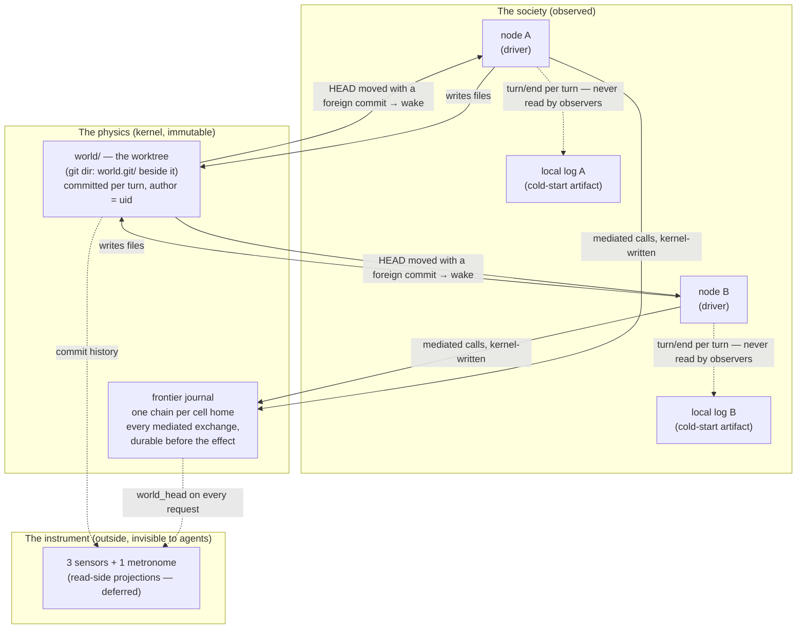
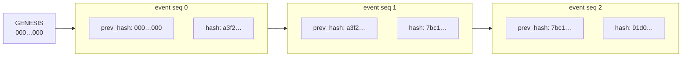
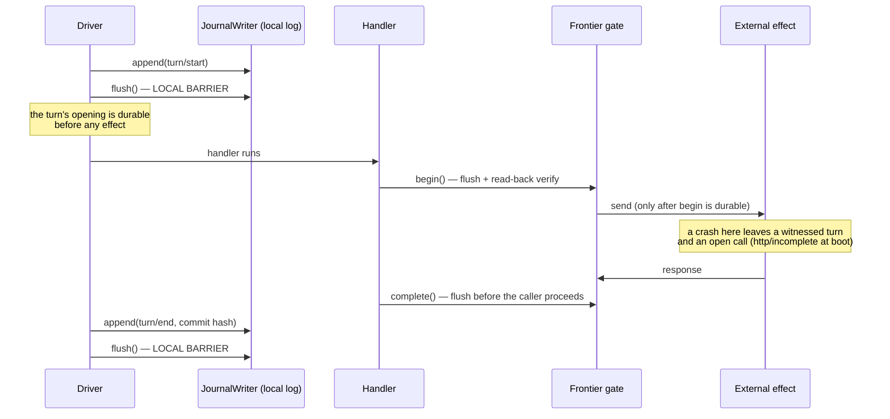
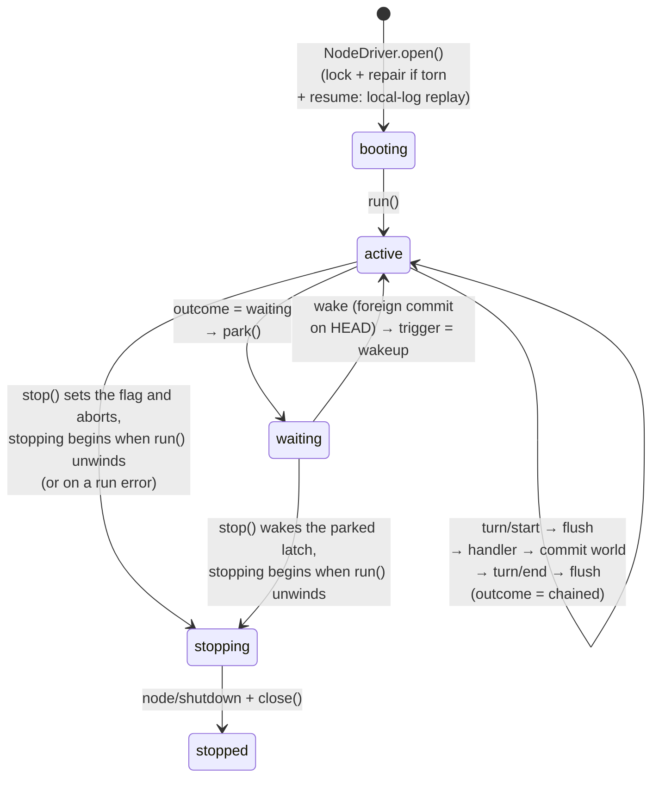
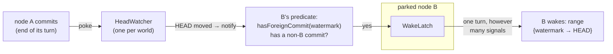

# Architecture — how the system works, from the top

This document is the **map between the concepts and the code**. It is the entry point for anyone who wants to understand how the software actually works before reading it: what the pieces are, how they relate, and where each concept of the design lives in the implementation. It stays deliberately **macro** — the micro level (every parameter, every error path) is the codebase's job, and the code is written to be read.

The rest of the corpus answers different questions: [vision.md](vision.md) says *why* the project exists and *what* it demonstrates; [seed.md](seed.md) and [direction.md](direction.md) specify the cold start and the co-negotiated direction; [kernel.md](kernel.md) is the authoritative technical spec, written *before* the code, with the rejected alternatives; [research/](research/) holds the evidence base; the per-checkpoint construction plans live in `docs/plans/` — a local, git-ignored working directory that is intentionally not published. This document is the one that goes **from the running code back up to the concepts** — it is maintained at each checkpoint closure, because the code is hardened beyond what the plans sketched, and the plans are construction notes, not maps.

Scope as of today: **C1.1 (the journal module), C1.2 (the node driver) and C1.3 (the durable context and provider boundary) are implemented and tested.** So are the C1.3 pieces a future host will drive: the context assembler, the fold, the committed surface, compaction, the bounded Git perception, one canonical provider wire with its adapter and transport, and disposable projection snapshots. So are the kernel-mediated web tools and their kernel-side credential store (**C1.4a**), the persistent terminal `execute` (**C1.4b**), its Landlock filesystem confinement (**C1.4c**) and the **frontier journal that now holds the truth while the per-node journal is demoted to a cold-start `log.v0.*` artifact (C1.4d)**. Everything beyond them is drawn here in dotted lines, as specified but not yet built: the credential broker's full placeholder↔endpoint substitution, the Package layer (C1.5), agent zero, chat and the disposable SQLite index (C1.6), and — of C1.7 — the escalating kill switch; frontier completeness and its proof (the acceptance harness) landed with C1.4d, so the kill switch is C1.7's remaining build item. There is no CLI, main process or running product yet — the implemented surface is the library source plus the runtime a future host would drive, not a launchable kernel.

---

## 1. The system in one picture

A perpetual society of LLM agents, observed. Three mechanisms carry the whole design:

1. **The frontier journal is the only truth** — every kernel-mediated exchange of every node (model calls, web-tool calls) is an event in one append-only, hash-chained log per cell home, written by the kernel at the HTTP boundary; the world's git history is the second observation surface. Everything else — dashboards, metrics, agent memory, and the per-node `log.v0.*` local logs — is a disposable projection or a cold-start artifact. What is recorded is the boundary fact, not an exhaustive trace: the frontier holds the mediated call and its terminal response; alongside it the node's local log records the top-level tool invocation and its result, and the world's git history records the observed diff — the shell's syscalls inside a turn are not individually logged.
2. **The world is the filesystem** — one git repository; nodes communicate only by writing files; the kernel commits the world at the end of every turn with the node's uid as git author.
3. **Wake-on-change** — the kernel watches the world's git HEAD; a node wakes when HEAD carries a commit it did not author. A static world spends no tokens.



The suture between the two observation surfaces has **both halves**: every frontier `http/request` carries `world_head` — the HEAD the kernel observed when it journaled the request, kernel-stamped and best-effort (`null` when unreadable), which places an exchange on the world's timeline — and every turn's `turn/end` in the node's local log carries the git commit hash the turn produced (an empty turn commits nothing and its closer is ignorable). The `turn/end` join is at *recorded turn boundaries* and is commit-granular, not per-file: at each recorded `turn/end` the commit that closed the turn is known and the perception is pinned to its recorded range, but an arbitrary `seq` is not an exact world snapshot — a shell write mid-turn, or a commit made outside any turn, has no per-`seq` mapping. The local half is a cold-start fact (observers never read the local log); the frontier→world join through `world_head` is the observation-surface one, and it joins a call to the world's timeline, never to a node. Neither surface alone suffices; together they are what makes metrology possible (see §4.3 for attribution and interrupted-turn reconciliation).

---

## 2. The full component map

```mermaid
flowchart TB
    subgraph LOOPBOX["src/node/loop.ts — the C1.3 runtime (implemented)"]
        LOOP["createAgentRuntime<br/>the trusted handler + hook bundle:<br/>fold, world perception, assembly,<br/>compaction, call dispatch, checkpoints"]
    end

    subgraph CTX["src/context/ — durable context (C1.3)"]
        CFG["config.ts — default config<br/>+ strict validation"]
        EV["events.ts — the boundary<br/>event vocabulary"]
        ART["artifacts.ts — canonical<br/>bytes + artifact resolution"]
        LOADER["loader.ts — the verified<br/>claim-check read"]
        FOLD["fold.ts — ContextFold:<br/>config, surface, open turn, recovery"]
        SURF["surface.ts — committed surface<br/>+ transactional compaction"]
        COMP["compaction.ts / groups.ts —<br/>policy + neutral group rules"]
        DIFF["diff.ts — presentWorld:<br/>bounded pinned Git perception"]
        ASM["assembler.ts — assemble():<br/>the one canonical plan"]
        SNAP["snapshots.ts — disposable<br/>projection checkpoints"]
    end

    subgraph PROVIDER["src/provider/ — the only kernel-mediated LLM provider path (C1.3 + C1.4d)"]
        WIRE["wire.ts — serializeWire:<br/>canonical non-streaming body"]
        ADAPTER["adapter.ts — ProviderAdapter:<br/>plan → wire → begin → send → complete"]
        TRANSPORT["transport.ts — OpenAITransport:<br/>wire facts, exact bytes, bounded body"]
    end

    subgraph FRONTIER["src/frontier/ — the truth (C1.4d)"]
        FEV["events.ts — http/request,<br/>http/response, http/incomplete:<br/>vocabulary, validators, allowlists"]
        FGATE["journal.ts — openFrontierJournal:<br/>begin before the send, complete before<br/>visibility, boot reconciliation"]
    end

    subgraph TOOLS["src/node/tools/ — tools (C1.3 + C1.4a + C1.4b + C1.4c)"]
        TERMINAL["terminal.ts — TerminalRuntime:<br/>persistent PTY session (run/dispose)"]
        SANDBOX["sandbox.ts — Landlock policy:<br/>grants, scratch leaf, functional probe"]
        LAUNCHER["native/es-landlock —<br/>vendored C launcher (C1.4c)"]
        PROC["proc.ts — stdin-wait proof<br/>(/proc)"]
        SAN["sanitize.ts — PTY output<br/>sanitization"]
        DISPATCH["dispatch.ts — dispatchCalls:<br/>complete tool dialogues"]
        WEB["web.ts — web_search / web_fetch:<br/>Tavily client + renderers"]
        PROVIDERS["providers.ts — loadProviders:<br/>kernel-side providers.json store"]
    end

    subgraph NODE["src/node/ — a node's engine (C1.2 + gate)"]
        DRIVER["driver.ts — NodeDriver<br/>turn ritual, watermark,<br/>resume, park/wake, shutdown"]
        GATE["gate.ts — the trusted gate<br/>chunking, manifests, barrier"]
        WORLD["world.ts — WorldRepo<br/>the world as a git repo,<br/>commit per turn (author = uid)"]
        WATCH["watcher.ts — HeadWatcher<br/>watches git HEAD,<br/>poke + interval"]
        LATCH["latch.ts — WakeLatch<br/>in-memory wake signal<br/>(coalescing)"]
        EVENTS["events.ts — node vocabulary:<br/>node/boot, node/shutdown,<br/>turn/start, turn/end"]
    end

    subgraph JOURNAL["src/journal/ — one storage module, two layouts (C1.1):<br/>the frontier stream (journal.v0.*) and the local log (log.v0.*)"]
        subgraph PUR["Pure core (zero I/O)"]
            ENV["envelope.ts<br/>event format + hash chain"]
            CANON["canon.ts<br/>RFC 8785 + SHA-256"]
        end
        subgraph STORE["Storage"]
            FRAME["framing.ts<br/>zstd frames,<br/>torn/corrupt scan"]
            BLOB["blobs.ts — BlobStore<br/>claim-check"]
            LOCK["lock.ts — single-writer lock<br/>flock guard + owner record"]
            FSU["fsutil.ts<br/>fsync, atomicWriteFile, writeAll"]
            LAY["layout.ts<br/>paths + Head shape"]
        end
        subgraph ACTORS["Actors"]
            WRITER["writer.ts — JournalWriter<br/>append, 200 ms timer,<br/>flush barrier, watermark,<br/>rollback, poison"]
            READER["reader.ts — JournalReader<br/>+ repair()"]
            VERIFY["verify.ts — verifyChain<br/>shared reader ↔ writer"]
        end
    end

    subgraph FUTUR["C1.5-C1.6 — specified, not yet implemented"]
        AZ["agent zero + speak + human chat + SQLite index"]
    end

    subgraph DISK["cell-home/ (the disk)"]
        FLOG["frontier/journal.v0.jsonl.zstd<br/>(CANONICAL — one chain per cell home)"]
        FHEAD["frontier/journal.v0.head (disposable)"]
        FLCK["frontier/journal.v0.lock (flock sidecar)"]
        FOWN["frontier/journal.v0.owner<br/>durable {pid, startedAt, token}"]
        LOG["nodes/&lt;uid&gt;/log.v0.jsonl.zstd<br/>(cold-start artifact — observers never read it)"]
        HEAD["nodes/&lt;uid&gt;/log.v0.head (disposable)"]
        LCK["nodes/&lt;uid&gt;/log.v0.lock (flock sidecar)"]
        OWN["nodes/&lt;uid&gt;/log.v0.owner<br/>durable {pid, startedAt, token}"]
        PROV["providers.json<br/>kernel-side credential store<br/>(C1.4a; its content unreadable from the confined shell)"]
        BLOBS["blobs/<2 hex>/<sha256><br/>(shared: local claim-checks + frontier bodies)"]
        GIT["world/ worktree + world.git/ + HEAD"]
        SNAPD["nodes/&lt;uid&gt;/snapshots/&lt;seq&gt;.json<br/>(disposable, retention 2)"]
    end

    DRIVER -->|"append turn/start, turn/end<br/>+ flush() barrier"| WRITER
    DRIVER --> EVENTS
    DRIVER --> GATE
    DRIVER -->|"commitAll(uid) every turn"| WORLD
    DRIVER -->|"subscribe / poke"| WATCH
    DRIVER -->|"wait() while parked"| LATCH
    WATCH --> GIT
    WORLD --> GIT
    WRITER --> ENV & CANON
    WRITER --> FRAME & BLOB & LOCK & FSU
    WRITER -->|"write + fsync (local layout)"| LOG
    WRITER -->|"write + fsync (frontier layout)"| FLOG
    WRITER -->|"atomicWriteFile (local)"| HEAD
    WRITER -->|"atomicWriteFile (frontier)"| FHEAD
    WRITER -->|"put (before the flush)"| BLOBS
    LOCK --> LCK
    LOCK --> OWN
    LOCK --> FLCK
    LOCK --> FOWN
    READER --> VERIFY & FRAME
    READER -->|"get (resolveBlobs)"| BLOBS
    VERIFY --> ENV
    WRITER -.->|"resume() verifies the chain"| VERIFY
    READER -->|"repair() truncates (local)"| LOG
    READER -->|"repair() + envelope scan (frontier)"| FLOG
    LOOP --> FOLD & ASM & COMP & DIFF & SNAP & DISPATCH
    LOOP -->|"gate.store / gate.capture"| GATE
    LOOP -->|"adapter.send(plan)"| ADAPTER
    ADAPTER --> WIRE
    ADAPTER -->|"assistant/message + flush"| GATE
    ADAPTER -->|"begin / complete"| FGATE
    ADAPTER --> TRANSPORT
    TRANSPORT -->|"POST exact bytes"| NET(["provider endpoint"])
    DISPATCH --> TERMINAL
    DISPATCH --> SAN
    TERMINAL --> PROC
    TERMINAL --> SANDBOX
    SANDBOX --> LAUNCHER
    DISPATCH --> WEB
    DISPATCH -->|"tool/call, tool/result,<br/>raw artifact (execute only)"| GATE
    WEB -->|"begin / complete"| FGATE
    FGATE --> FEV
    FGATE -->|"append, flush, read-back verify"| WRITER
    FGATE -->|"body blob before the append"| BLOBS
    PROVIDERS -.->|"webToolsFromProviders"| WEB
    SURF --> ASM
    COMP --> SURF
    FOLD --> SURF
    DIFF --> WORLD
    SNAP --> SNAPD
    ART --> LOADER & FOLD
    EV --> GATE & FOLD
    CFG --> FOLD
    AZ -.-> LOOP
```



How to read this map:

- **The driver is the local writer's only client.** The runtime (and any trusted C1.3 handler) gets a narrow `TurnContext` — no journal, no commit, only the boundary gate. That is the guarantee that *only the kernel emits*.
- **Replay refuses an incomplete vocabulary before it takes the writer.** With hooks, the driver checks the whole contract up front: `readHistory`, `readBlob` and `acknowledgedWorld` must all be present, and the `knownTypes` set must cover both the node lifecycle types and every type in the registry — a set missing either is refused explicitly and early, rather than surfacing later as an unknown-event replay failure.
- **The LLM provider path is the only *mediated* LLM path today; both mediated paths cross the frontier.** `src/provider/` is the only kernel-mediated LLM provider transport — `src/node/tools/web.ts` is a second kernel-mediated provider path, but it carries no model request; the shell is filesystem-confined (C1.4c) but its egress is unmediated and it can open its own sockets, so this is not an exclusive network claim; egress is left open by explicit decision for the experimentation phase. The C1.4a mediated web tools and their credential store are implemented and cross the frontier (C1.4d); the full placeholder↔endpoint broker is not.
- **The gate is the runtime's local effect boundary.** `src/node/gate.ts` owns chunking, artifact manifests and the claim-check inline threshold, so a handler never touches the writer; its `flush()` is a durable barrier that re-reads and digest/size-verifies every pending claim-check before the effect is allowed. The frontier's gate (`src/frontier/journal.ts`) is the HTTP boundary: `begin` is durable and read-back verified before the transport sends, `complete` before the caller proceeds.
- **The driver also owns the world**: every turn ends in a commit → HEAD moves → the shared watcher (one per world) announces the movement → each parked node evaluates *its own* predicate (a commit I did not author?) → its latch wakes it.
- **`world.ts` is a façade over six siblings.** The map above draws one world file because `WorldRepo` is the surface a node's engine speaks to; the implementation is `world.ts` (the policy) plus `world-types.ts` (the data shapes), `world-git.ts` (the git process layer), `world-trust.ts` (the trust layers `open` runs), `world-history.ts` (the history reads), `world-diff.ts` (the hermetic patch renderer) and `world-commit.ts` (the commit machinery). No module outside the `world-*` family imports a sibling directly: the driver and the context depend on `WorldRepo` and its types, and the tools on the `realpathOrSelf` helper `world.ts` re-exports.
- **The C1.3 runtime is the trusted handler.** `createAgentRuntime` folds the node's local log, presents one bounded world perception per turn, assembles exactly one plan per logical request, sends it through the adapter, and dispatches the resulting tool calls. It never hands the writer to the model and never invents a second message, request, artifact or state shape.
- **`verify.ts` is the meeting point** between write and read: the writer's `resume()` replays exactly the rules the reader applies — a stream valid for one is valid for the other, for the frontier and the local log alike.
- **On disk, the canonical records are the frontier journal, the payload blobs it references, the node's local log, and the world's git history**: `<home>/frontier/journal.v0.jsonl.zstd`, `blobs/…`, `<home>/nodes/<uid>/log.v0.jsonl.zstd`. The head, the lock and owner sidecars, the SQLite index and the projection snapshots are disposable; the blob store is not — it carries the original payloads the events only reference (frontier bodies and local claim-checks), and is shared across nodes (content addressing makes that safe). The world's git history is the second observation surface: `world_head` on every frontier request joins an exchange to the world's timeline, and `turn/end` in each node's local log joins a recorded turn to its commit.

---

## 3. The two records: the frontier stream and the local log

### 3.1 The hash chain

Every event is an envelope with a frozen field set: `{v, type, seq, time, prev_hash, hash, ignorable?, data}`. The chain rule (`envelope.ts:57`):

```
hash(n) = SHA-256( hash(n-1) + canon({v, type, seq, time, [ignorable], data}) )
```

Two ingredients make this meaningful:

- **Canonicalization (RFC 8785 / JCS, `canon.ts`)** — hashing runs on bytes, and logically-equal JSON can serialize many ways (key order, number forms). JCS imposes one byte representation per value; anything that cannot serialize losslessly (`undefined`, `NaN`, cycles…) is *refused*. Without it, a hash could not distinguish "altered" from "rewritten in another key order". This is a **data-only contract at a trusted boundary, not a non-bypassable one**: only own enumerable data properties of plain objects and full arrays are read, no accessor and no `toJSON` hook (own or inherited) is ever *called* — a callable or accessor `toJSON` is refused instead — and a key literally named `__proto__` is preserved as an ordinary own data property rather than routed through a prototype setter. An exotic object (a `Proxy`) that misreports its own descriptors is explicitly out of scope.
- **The prev_hash link** — each event embeds its predecessor's hash, starting from `GENESIS_HASH` (64 zeros). So `hash(n)` is indirectly a fingerprint of the whole history up to `n`: the chain's last hash summarizes the entire stream.



Why tampering cannot hide: modify one byte of an old event and its recomputed hash changes (avalanche); the next event's `prev_hash` no longer matches; fixing that requires rewriting the event, which breaks the next link, and so on to the tip. **Append-only by construction**: rewriting the past requires rewriting the whole future — and the tip hash cited anywhere else will not match.

Verification (`verify.ts`) replays from genesis and applies six rules to every event: frozen field set and well-formed hashes; **canonical line encoding** — the stored line must be exactly the canonical serialization of the event it parses to, so a re-indented, duplicate-key or alternate-escape line is refused rather than reinterpreted; `v === 0`; **contiguous `seq`** (a deletion leaves no broken hash but a visible hole — completeness is checked by numbering, not by hashing); `prev_hash` linkage; hash recomputation. The walk never skips the beginning, even when the caller only wants a suffix.

This is closer to **git than to a blockchain**: one writer per stream (enforced by the lock), and detection rather than economic prevention. The chain physics differ by artifact: the **frontier journal is one global chain per cell home** because one writer serialises every `begin` — the egress queue already exists, so the total order is free — while the **node's local log is a chain per node, not global; a global local chain would serialize all writers**.

### 3.2 Persistence: fast writes that survive crashes

Two constraints fight each other: `fsync` costs too much to run per event, yet "model-visible means logged" forbids any external effect without a durable trace. Three mechanisms reconcile them.

**Frames.** The log file is a concatenation of independent, length-prefixed, checksummed zstd frames. A flush writes one or more consecutive frames — a burst is split when its decompressed size would reach the frozen `MAX_DECOMPRESSED_BATCH_BYTES` — all covered by one `fsync`, the unit of durability. Appending never touches existing bytes (the file is opened in `'a'` mode), and the length prefix lets a reader walk frames without decompressing the whole file.

**Write-behind.** `append()` is synchronous and in-memory: hash, capture the canonical line, push to `pending`, return. The *first* event of a burst starts a 200 ms timer (no debounce — the window never resets); when it elapses, the whole burst is written as consecutive frames, one fsync. The hot path never blocks on I/O, and a failed write restores the batch for retry instead of dropping it.

**The flush barrier splits by artifact.** On the **frontier**, `begin` flushes before the send and `complete` before the caller proceeds — durability *before effect*, then durability *before visibility*; a call whose `complete` never lands is reconciled at boot as `http/incomplete`, a fact rather than a guess. On the **local log**, the barrier covers the turn envelopes and the gate's artifact writes: the driver flushes at `turn/start` (before the handler can act) and at `turn/end` (before the loop unwinds, because the closer carries the world commit hash: an orphan commit would be an effect without a trace).



**Watermark, rollback, poison.** The writer tracks both the in-memory tip (`seq`, `prevHash`) and the durable watermark (`committed.bytes/seq/lastHash`). A failed write restores the batch *and* truncates the log back to the watermark so the retry is clean. Two consecutive failures — or a failed rollback — **poison** the writer: every later append/flush/close is refused. Retrying over a partial frame would bury the tear mid-log and hide every later event; a typed terminal state beats a record that silently lies.

**Ownership.** A stable flock sidecar serializes every lifecycle transition, while the exclusive right itself is a separate durable record naming the owner process `{pid, startedAt, token}`. The names are **per profile**: `frontier/journal.v0.lock` and `frontier/journal.v0.owner` for the one writer per cell home, `nodes/<uid>/log.v0.lock` and `nodes/<uid>/log.v0.owner` for each node's local writer. The read-decide-write of that record runs in a short-lived helper process launched by `flock -F` — no fork, no persistent lease process — so a partially written record is impossible and a crashed helper releases the kernel lock by itself, while a dead owner's record is reclaimed under the guard. Release is token-bound (it clears only the record it created, never a later owner's) and a genuinely unknown guard outcome triggers a token-conditional cleanup; repair likewise runs under the exclusive guard. The mechanism requires Linux util-linux `/usr/bin/flock` and `/proc` (pid start times), and is not a shared-disk (NFS/multi-host) protocol.

**Durable directories.** Before a log batch or a blob reference can be durable, its directory entry must be: `ensureDurableDirectory` creates each missing level from a trusted root — the cell home, which the caller owns — and fsyncs each level's parent top-down, re-proving the whole chain on every call rather than caching a pathname. The fsync chain stops *below* the cell home; a missing home is created and proven up to its first existing ancestor. Head failures are the deliberate exception: the head checkpoint is written only after the batch it describes is durable, so a head write that fails is reported as a diagnostic (the writer's `onError`) and the flush still succeeds — losing the head costs a rebuild, never the committed log, and a head failure never poisons the writer.

**Crash repair: torn tail vs interior corruption.** A crash mid-write leaves a final fragment. `scanBatches` reads its length prefix: the announced frame overruns EOF — but is that a partial write or a flipped length bit? The discriminator is the payload: every zstd frame starts with the magic `28 B5 2F FD`.

```mermaid
flowchart TD
    P["prefix announces N bytes<br/>but EOF comes first"] --> M{"do the present bytes<br/>start with the zstd magic?"}
    M -->|no| T["TORN TAIL<br/>not even a frame start<br/>→ repair() may discard"]
    M -->|yes| D{"does the available payload<br/>decode fully?"}
    D -->|yes| C["INTERIOR CORRUPTION<br/>a whole frame existed, only the prefix lied<br/>→ CorruptFrameError — never truncate"]
    D -->|no (strict prefix of a frame)| T2["TORN TAIL<br/>genuine partial write<br/>→ repair() may discard"]
```

`repair()` — the system's only destructive path — truncates at the last valid frame, fsyncs file and directory, and deletes the stale head. Events lost this way were never durable, so nothing durable references them; an interrupted *turn* is a different matter — its durable events stay, and resume appends a synthetic `interrupted` closer. Interior corruption is never truncated: it would throw away valid events behind the damage. Symmetrically, the writer *refuses to open* a torn log (`TornTailError`); the driver catches it at boot, runs `repair()`, and reopens.

The module's philosophy, everywhere: **refuse rather than guess** — unknown version, unknown non-ignorable type, truncated blob, corruption, repeated write failure all end in typed terminal states, never in "carry on and hope".

### 3.3 Claim-check blobs

A local payload whose canonical UTF-8 byte length is **at or past 16 KiB** (`CLAIM_CHECK_THRESHOLD`) leaves the log: the event's `data` becomes a reference `{blob, size}`, and the canonical bytes go to the blob store. At or past 4 MiB (`MAX_BLOB_BYTES`) the blob holds only a prefix and the reference is flagged `truncated: true` with the original byte size — the loss is explicit, never silent. Both thresholds are format constants, unchanged in v0, and both comparisons are inclusive. **The frontier never claim-check-truncates a body**: a frontier event's payload is small by construction (its bodies are references, and the validators refuse any event that would reach `CLAIM_CHECK_THRESHOLD`), the blob holds exactly the captured bytes, and a bounded HTTP capture is recorded whole and flagged `complete: false`. The two bounds act on opposite sides: `FRONTIER_MAX_BODY_BYTES` (32 MiB) fail-closes *requests* at `begin` — nothing is sent — while *responses* are bounded by the transport's own `maxBytes` and journaled whole. The chain hashes the *reference*, so verification of the log never needs the content; resolution happens afterwards. The raw reader's default returns the reference unchanged and does **not** verify the blob's bytes — a verified read (the digest and exact byte length, then the JSON parse) goes through the context loader and the driver's flush barrier (local), or the frontier gate's read-back verification (frontier):

- `src/context/loader.ts` re-exports the journal module's `BlobIntegrityError`, so every consumer names one corruption kind. That error is a journal-module `CorruptionError`: a reference flagged `truncated` is refused before any read; a short, digest-mismatched or non-JSON blob raises it; a *missing* blob (ENOENT) is mapped to it. Any other read failure (EACCES, EIO, a path-shaped hash) propagates with its own type — an environment failure is never reclassified as corruption.

The store is plain files under `blobs/<2 hex>/<sha256>`, **shared across all nodes and by both layouts** — the local log's claim-checks and the frontier's bodies:

- **Content addressing** — the file name *is* the content's SHA-256: deduplication is free (a repeated payload is stored once, and a retried request reuses one body blob), a blob's integrity is checkable by re-hashing against the name, and sharing across nodes is safe. The write path is content-addressed; the raw read path does not re-check that, so every verified read routes through `src/context/loader.ts` or the driver's flush barrier (local), or the frontier gate's read-back verification (frontier), which prove the digest and byte length before trusting the bytes.
- **Atomic writes** — temp file, fsync, rename: a crash cannot leave a torn blob under a trusted name.
- **Blobs before events** — the flush drains pending blobs *before* writing the frame that references them; a blob failure counts in the same poison streak as a log failure. The frontier gate writes and verifies the body blob before it appends the event that references it, at both `begin` and `complete`.

---

## 4. The node driver: a node's breathing loop

Three files collaborate: `driver.ts` (orchestration), `world.ts` (the git world), `watcher.ts` (the HEAD signal). `world.ts` is the façade: it owns the repository's policy and delegates the mechanics to five siblings — `world-git.ts` (the git process layer), `world-trust.ts` (the trust layers `open` runs), `world-history.ts` (the history reads), `world-diff.ts` (the hermetic patch renderer) and `world-commit.ts` (the commit machinery) — while taking the shared data shapes from `world-types.ts`.

### 4.1 The turn ritual



Each turn: open on the world range `{from: watermark, to: HEAD}`, append `turn/start` and flush, call the handler with a narrow `TurnContext` (`{turn, trigger, world, gate, signal, now}` — no journal, no commit; `gate` is the turn's boundary gate, revoked when the turn closes, and `signal` is the turn's cancellation signal), commit the world with the node's uid as author, append `turn/end` with the commit hash and flush, then either chain a further turn or park.

Four event types only: `node/boot`, `node/shutdown`, `turn/start`, `turn/end`. A crash is the *absence* of `node/shutdown`; an interrupted turn is closed at resume by a **synthetic** `turn/end {outcome: 'interrupted'}` after its leftover writes are committed under the node's authorship — an effect is never left unattributed.

**Closers and failures.** A `turn/end` is flushed per event before the loop unwinds, because it carries the world commit hash and an orphaned commit would be an effect without a trace. When the handler throws, the turn's leftover writes are committed under the node's authorship and the turn is closed with an error closer, but the original handler failure outranks any commit-or-closer fault (both are caught, the writes stay for the next commit); the turn gate is revoked in a `finally` on every exit. Under C1.3 hooks only a bounded fixed label — a durability, maintenance or kernel-invariant failure — ever reaches the local log as the error, so no message, payload or secret is recorded.

**The empty turn.** A turn with no tool call and no world change is still a turn — recorded in the node's local log, committing nothing. Its closer carries the envelope's `ignorable` mark: emptiness is knowable only once the turn has ended, so the closer is the skip unit. A reader that does not model empty turns may skip them; the context assembler is the reader that does. The metrology does **not** see them: it reads the frontier journal and the world, and the local log is a cold-start artifact no observer reads — a run of empty turns is "polite waiting", and that phenomenon leaves the observation surface (stated as a residual in the C1.4d plan — a local, unpublished construction note; §9).

### 4.2 Wake-on-change

The watcher monitors the world's git **HEAD**, not the filesystem: no inotify, no filesystem-level partial-write races, nothing to debounce. Each wake is pinned to an **opening range** (`{watermark → HEAD}` at the moment the turn opens), so perception is taken at a commit boundary, never mid-write. HEAD is not moved only by a node's turn — a human or external commit can land between turns — so commits may arrive between the pinned bounds and are covered by the next wake's range; this is a commit-boundary guarantee, not a claim that no event is ever missed. It announces *movement*, not *waking*: deciding whether a movement concerns a given node is that node's predicate. Its first read announces the HEAD it finds (including an unborn HEAD) to set a baseline; later reads announce only a change.



Consequences that are all load-bearing: a static world produces no wakes and spends no tokens; a dialogue is alternating commits; a node's own commits never wake it (self-excitation by writing is impossible); wakes coalesce at three levels (the latch, the watcher's pokes, and the single `hasForeignCommit` question over the opening range, answered from the bounded author stream that stops at the first foreign commit — several commits are still one answer, hence one wake). The `poke` path gives in-process dialogues minimal latency; an interval catches out-of-process commits (the human's, another kernel's). Read failures on the wake path *delay* a wake, never kill the node; durability failures (commit, flush) are fatal — a missed question costs a turn, a lost answer costs a fact.

**The watermark** is the node's perception cursor: the HEAD its last turn opened on — rebuilt from the node's local log at resume, never from the current HEAD, so a node that slept through changes wakes on what it missed. It advances at turn *opening*: what a turn perceives is frozen when it opens, and a foreign commit landing mid-turn belongs to the next turn.

**With C1.3 hooks the watermark is proven, never declared.** A hookless legacy driver advances its watermark at the `turn/start` barrier, which *is* its perception of the range. A hooks bundle advances it only from a verified durable `world/perception`: the runtime records and observes one perception per turn, and the driver moves the watermark only when that acknowledgement names the current turn, the exact opening range, and a source that is a delivered observation carrying the same wrapper — checked in O(1) against the delivered index, never by rescanning and never against a pending receipt. A perception whose rendered text is empty still proves the range (the ack is the recorded perception, not its text). A handler that owns no perception returns null and its prior watermark stands. The result is that a turn that failed before recording a perception — including a Git renderer that failed closed — is re-presented after a restart rather than skipped: a missed perception costs a re-presentation, never a missed fact.

### 4.3 The world as a git repo

`world-git.ts` drives the git CLI as an external process (auditable byte for byte) through one controlled environment, and `world-commit.ts` builds the commit; the node's uid is both author and committer identity, and `world.ts` is the façade that owns the policy between them. Commits are serialized twice in `world-commit.ts`: an in-process queue per world (two drivers must never interleave the staging and publishing of a commit), and a bounded retry (4 attempts at 25/50/75 ms) on git's lock or a lost compare-and-swap (external writers exist — the human). A commit is built from plumbing — `add --all`, `write-tree`, `commit-tree`, `update-ref` — never `git commit`: the latter writes the repository-wide `.git/COMMIT_EDITMSG`, so two concurrent commits race on one shared file (the observed "empty commit message" abort). The branch moves by compare-and-swap, and the returned hash is the one `commit-tree` produced for this call, so the hash recorded in `turn/end` can never name a peer's commit. Attribution is still commit-granular: with one shared working tree a turn-end commit can carry a peer's in-flight writes, and the git layer says who moved the world when, not who wrote every line. Per-file attribution is not recoverable today (per-node worktrees are the research direction); the local log is a cold-start artifact and never an attribution source. Hard guards refuse an unsafe world path (`$HOME`, `/`, a symlink resolving to one — the 200 GB lesson); the world's git dir is a **separate real directory outside the worktree** (`<home>/world.git`), recorded in its own config as an absolute `core.worktree` and verified at every open; a single branch is fixed — `init` creates `main`, and the kernel then operates on whatever local branch HEAD names without switching it during a run (a detached HEAD or a non-`refs/heads/` HEAD is refused, and a concurrent checkout during a commit is unsupported rather than promised closed). The git environment variables that redirect or inject configuration are stripped (`GIT_DIR`, the `GIT_CONFIG_*` family including `GIT_CONFIG_PARAMETERS`, and inherited replace refs, which are neutralized with `GIT_NO_REPLACE_OBJECTS`), system and global config are neutralized, and lazy fetch is disabled with `GIT_NO_LAZY_FETCH=1`. Reading physical committed objects matters: the kernel ignores a `refs/replace` projection. Five trust layers keep the git inputs kernel-owned (kernel.md §5.2, §7), split by module. **Layers 1–3** are the verification layers `verifyGitDirTrust` runs on every `open`, in `world-trust.ts`: a `-z` config scan (every entry's origin must be the git dir's own config file; execution-capable and history-rewriting keys are refused); a metadata battery (regular config; no `config.worktree`/alternates/grafts/shallow; hooks only `*.sample`; a bounded walk refusing any symlink and any multiply-linked non-directory); and the absolute-`core.worktree` pair check. **Layer 4** is the pair and defense-in-depth `-c`s on every kernel git call against the opened repo (`--git-dir`/`--work-tree` plus `-c log.showSignature=false -c core.hooksPath=/dev/null`), built by `gitBaseArgs` in `world.ts` and present on every command that runs against the opened repo (the open-time scan and pair probe, `init`'s own setup calls, and the scratch-view diff are the deliberate exceptions). **Layer 5** is nested-repo neutralization at commit, in `world-commit.ts`. The agent inputs that remain are the worktree's `.gitattributes` (attribute effects only — no filter/driver exists in the kernel-owned config) and `.gitignore` (a designed semantic); nested repository content is never committed, and a root-level `<world>/.git` is ignored at open and never staged. Migration from a legacy in-world `.git` is a hard break with a sanitizing recipe in the README. Git at or above **2.42** is required for `GIT_ATTR_SOURCE` (older Git would silently read working-tree attributes); this is a documented floor, not a version guard.

**Interrupted-turn reconciliation.** At resume an open turn is closed synthetically, naming the commit its own turn already made when it can prove one. The search base is the turn's opening `to` (never the prior acknowledgement), the candidate must carry both the node's uid and the exact subject `turn N`, the walk is bounded (4096) and refused rather than truncated, and an ambiguous match (more than one) or a missing/unreachable base fails typed. With no matching commit, the working tree is committed whole as this node's own recovery commit — one commit, named by hash — and because the git layer stages the whole tree (`add --all`), a peer's dirty files are swept in with the node's own; the one-candidate path names the existing commit and stages nothing. This is a jointure, not cryptographic authentication of the actor, and it is not an atomic Git-and-local-log transaction. Nothing here rewrites history or prunes objects — replay must be able to resolve the recorded objects — and garbage collection of the world is owned by no component yet; the future main host (C1.6) owns those policies before any appliance.

---

## 5. Mechanism and policy: the frontier the agents cannot cross

The design's load-bearing boundary (`kernel.md` §1.6, §5.5):

| | Lives in | Mutable by the organism? |
|---|---|---|
| **Mechanism (physics)** — the frontier journal + hash chain, the node's local log, mutation gate, watcher, commit-per-turn, turn ritual, kill switch, sandbox, budget ceiling | the kernel | **No** — an organism that could rewrite these could rewrite the measurement apparatus |
| **Policy (phenotype)** — when to wake, what enters the context, what is retained, loop/compaction policies, tools, instincts | behavior Packages (C1.5) | **Yes** — via `extend`, and every policy change is recorded in the node's local log (never a frontier fact) |

Everything already implemented is mechanism except one deliberate exception. The first policy arrived with C1.3: the assembler and the compaction policy decide what a wake's diff presents and what is retained, and they are implemented — but as **trusted kernel-side behavior**, not as a replaceable behavior Package. That is the load-bearing distinction: today's organism cannot rewrite the fold, the surface or the compaction policy; at C1.5 they become seed Packages mounted behind the same gate. Until then every policy change is a kernel-side decision recorded in the node's local log, not an organism-rewritable one — and not a frontier fact (the frontier records HTTP exchanges only).

---

## 6. What exists, what comes next

Implemented and tested:

- **C1.1 — the journal module** (`src/journal/`): envelope + hash chain, RFC 8785 canonicalization, zstd frames, claim-check blobs, flock-guarded single-writer ownership with a durable owner record, write-behind with flush barrier, watermark/rollback/poison, verifying reader, torn-tail repair — one storage module, two layouts since C1.4d (`journal.v0.*` for the frontier, `log.v0.*` for a node).
- **C1.2 — the node driver** (`src/node/`): turn ritual, commit-per-turn with uid authorship (git plumbing, conditional ref publication), wake-on-change over HEAD, free loop with explicit unbounded wait, empty turns, resume with synthetic closers and interrupted-turn reconciliation.
- **C1.3 — the durable context and provider boundary** (`src/context/`, `src/provider/`, `src/node/gate.ts`, `src/node/loop.ts`, `src/node/tools/`): the trusted boundary gate with its verified claim-check loader; an incremental `ContextFold` (config, committed surface, open turn, recovery); the provenance-bearing `Surface` and transactional compaction over whole committed groups (always excluding the heading pin); the bounded pinned Git perception (`presentWorld`); the pure assembler (`assemble`), whose plan is never journaled; one canonical non-streaming wire and its adapter and transport (since C1.4d the wire facts cross the frontier — `begin` durable before the send, `complete` before the caller proceeds; bounded retries on 408/429/500/502/503/504); and disposable projection snapshots (retention 2, best effort). The plan↔wire witness chain is retired as a fold invariant, and its offline check (`rederivePlans`) is gone with the plan event; an independent perception re-derivation survives as a test helper, and the acceptance harness re-derives the plan↔wire join offline. The plan is retired, not the proof.
- **C1.4a — the kernel-mediated web tools** (`src/node/tools/web.ts`, `src/node/tools/providers.ts`): `web_search`/`web_fetch` over a kernel-side credential store (`<home>/providers.json`, outside the world when the host follows the documented layout), a bounded Tavily client with classified outcomes and rendered results, dispatched through the same gate as the shell. The kernel takes the key from the store only to place it in the `Authorization` header; it interpolates the stored key into no event, artifact, world write or model request. The full placeholder↔endpoint broker is not built. Since C1.4d every web invocation **crosses the frontier**: `begin` is durable and read-back verified before the fetch, `complete` before the caller proceeds; the local `tool/call`/`tool/result` pair carries only `frontierCall` (null exactly on the already-aborted path, where no call was begun) and **no raw capture** of the web response. Only `execute` keeps a local raw artifact. The provider response body is captured verbatim up to `maxResponseBytes` and journaled at the frontier (`complete: false` when the cap stops the read), so a hostile provider can reflect the key into its response body; that body is rendered (bounded) into the local tool result and can reach a later model request through `wire.ts` — accepted for the experiment phase, the reflection residual stated in kernel.md §7. With C1.4c delivered the store's content is unreadable and unwritable from the confined shell (it remains plaintext at rest, protected by the kernel's filesystem policy, not encryption), and a `denied` result still does not distinguish "not allowed" from "no credential configured" (per-node attenuation rides on `allowedTools`).
- **C1.4b — the persistent terminal `execute`** (`src/node/tools/terminal.ts`, `proc.ts`, `sanitize.ts`): one PTY session per node behind a 2-method `TerminalRuntime` port (`run`/`dispose`), nonce markers on one physical line, typed statuses (`completed` | `stdin_read` | `timeout` | `session_exit` | `cancelled` | `spawn-failed`), one active write per node, a bounded per-command capture instead of a replayable scrollback, reset-on-timeout, an env allowlist, and no survival across a kernel restart. Three deliberate divergences from DSH's `tool-bash-persistent`: a stdin-wedged session is reset before the next command rather than silently fed the next command line, a capture overflow never kills the command, and completion wins over a same-tick abort (the completed check precedes the abort check, so a command whose end marker already landed is reported `completed`, not `cancelled`). The interactive `write` verb is not built; `execute` is confined by default since C1.4c. The PTY merges stdout and stderr into one stream; the model-facing render is sanitized, while the local artifact keeps the verbatim bytes of the bounded capture.
- **C1.4c — Landlock filesystem confinement of `execute`** (`native/es-landlock/`, `src/node/tools/sandbox.ts`, `src/node/tools/terminal.ts`, `src/node/loop.ts`): the vendored launcher (~400 lines of non-blank, non-comment C11; 516 lines total) self-restricts with Landlock (ABI floor 3, per-target-type right masking, `SCOPE_SIGNAL` and `SCOPE_ABSTRACT_UNIX_SOCKET` at ABI ≥ 6) and `execve`s bash in place, preserving pid, session and controlling tty. The kernel builds a strict allowlist (world and per-node scratch leaf rwx; merged-usr dirs rox; a narrow `/etc` file list plus `/etc/ssl/certs`, and `/proc`, ro; five device files individually) and runs a functional probe at first execute (write/read-back/remove in each writable dir, an exact-`EACCES` deny read, and the paired `/proc` ptrace check). A launcher failure is exit 125 plus one `es-landlock:` stderr line, classified `spawn-failed` only under the documented conjunction; `sandboxStatus()` reports `{mode:'off'}`, `null` or `{mode:'landlock', abi, enforcement}` without being journaled; `terminal.sandbox: false` is the explicit, loud opt-out. The world's git dir lives beside the worktree as `world.git`, not inside it, so the shell has no path to the world history. Egress stays open by decision; metadata mutations, pathname sockets, `/proc` stat surfaces and resource exhaustion are documented residuals (kernel.md §7).
- **C1.4d — the frontier journal, and the local log demoted** (`src/frontier/events.ts`, `src/frontier/journal.ts`, `src/frontier/index.ts`, `src/journal/layout.ts`, `src/provider/adapter.ts`, `src/node/tools/web.ts`, `src/node/loop.ts`): one in-process frontier writer per cell home (`<home>/frontier/journal.v0.jsonl.zstd`), a three-type vocabulary (`http/request`, `http/response`, `http/incomplete`) with no node, turn, provider, model, token or cost field, `openFrontierJournal(home, { worldHead, now })` returning a gate whose `begin` is durable and read-back verified before the send and whose `complete` is durable before the caller proceeds, boot reconciliation of an open call as `http/incomplete` (the journaled request set is a superset of the sent set: a `begin` followed by a pre-send cancel leaves a request with a cancelled terminal, and no terminal asserts that bytes reached the socket), and the two producers (the provider adapter and the Tavily web tools) crossing it. The per-node files are renamed `log.v0.*` and slimmed to the semantic vocabulary (`request/plan`, `request/wire`, `response/raw`, `request/usage` and `assistant/attempt` leave; `assistant/message` and `tool/result` carry `frontierCall`), and the local log is documented as a cold-start artifact observers never read. The acceptance harness proves the contract (frontier completeness, the static scan, the offline join).

Bootstrap is still the **full history fold of the local log**: a checkpoint is an accelerator hint only, never a substitute for chain verification or the fold, so no snapshot-accelerated boot is present and no constant-memory claim is made (the verified in-memory inventory is O(events)); the frontier's boot is likewise a full read plus the orphan scan. The gate and its verified claim-check loader are trusted kernel-side code, not a replaceable Package.

Next, in the order of `kernel.md` §10:

- **C1.4** — tools, in four lots, all **implemented**: **C1.4a** the kernel-mediated web tools (`web_search`/`web_fetch`) over a kernel-side credential store (the broker's mediated subset; the full placeholder↔endpoint substitution, third-party APIs without any secret entering the world, stays the documented target); **C1.4b** the persistent PTY `execute` (one session per node behind `TerminalRuntime`, typed statuses, bounded per-command capture; the three deliberate divergences from DSH are that a stdin-wedged session is reset rather than fed, that a capture overflow never kills the command, and that completion wins over a same-tick abort; the interactive `write` verb stays deferred); **C1.4c** Landlock filesystem confinement (the persistent shell is confined by default through the vendored launcher, so the credential store's content is unreadable and unwritable from it — plaintext at rest; the protection is the filesystem policy, not encryption); **C1.4d** the frontier journal (the truth moved to `<home>/frontier/`, the per-node log demoted to `log.v0.*`, both mediated producers crossing the frontier, proven by the acceptance harness). Egress stays open by explicit decision for the experimentation phase; the confinement is scoped to filesystem content, and its residuals are listed in kernel.md §7.
- **C1.5** — `extend`: Plugin → immutable Packages → Runs, persisted by local-log replay, executed in `node:vm` behind a restricted facade (and the frontier carries no Package vocabulary: a Package receives no frontier handle and no network); the C1.3 context and compaction policies are mounted here as seed Packages.
- **C1.6** — agent zero (root custody node, sole holder of the human channel, direction drafting) + chat + `speak` + the disposable SQLite index and projections (the index keys the frontier stream); also the main host that owns process lifetime.
- **C1.7** — frontier completeness (every mediated call durable before the send and terminal before visibility, proven by the acceptance harness) + escalating kill switch.
- **Then** — the monitoring session: the 3 sensors (semantic trajectory, structure graph, value registry) + the metronome (versioned direction), read-side projections feeding the cockpit. Specified in [research/monitoring-architecture.md](research/monitoring-architecture.md).

---

## 7. Concept ↔ code map

| Concept | Where it lives |
|---|---|
| "The frontier journal is the only truth" | `src/frontier/` (vocabulary + gate) on top of `src/journal/`; head, lock and owner sidecars, SQLite index and snapshots disposable — the hash-chained frontier stream and the payload blobs it references are the canonical record. The node's `log.v0.*` local log is a cold-start artifact observers never read |
| Append-only / hash chain | `src/journal/envelope.ts` (`computeHash`, `makeEvent`, `verifyEvent`); one chain per cell home for the frontier, one per node for the local log |
| Canonical bytes | `src/journal/canon.ts` (RFC 8785, refuse lossy values, data-only copy) |
| "Model-visible means logged" | frontier: `begin`/`complete` in `src/frontier/journal.ts`, each flushing and read-back verifying before send/proceed; local: the `flush()` barrier in `writer.ts`, called at `turn/start`/`turn/end` in `driver.ts` and around every gate capture |
| Durability batching | `framing.ts` (frames) + the 200 ms timer in `writer.ts` |
| Never lose an event silently | watermark + rollback + poison in `writer.ts`; frontier reconciliation appends `http/incomplete` for an open call at boot |
| Crash repair | `repair()` in `reader.ts` + the magic-number test in `framing.ts`, for both layouts |
| Claim-check | `blobs.ts` + `claimCheck` in `writer.ts` (local payloads); frontier bodies are blob references and are **never** claim-check-truncated; raw refs resolved by the verified read in `src/context/loader.ts`, the driver's flush barrier, or the frontier gate's read-back |
| One writer per stream | `src/journal/lock.ts` (flock sidecar + durable `{pid, startedAt, token}` owner record), one frontier writer per cell home and one local writer per node |
| The world is the filesystem | `src/node/world.ts` (`WorldRepo`, the façade: author = uid) over `world-git.ts` (the git process layer) and `world-commit.ts` (the plumbing commit) |
| Wake-on-change | `src/node/watcher.ts` + `driver.ts` `wakeNeeded`, which asks `WorldRepo.hasForeignCommit` (delegated to `world-history.ts`) |
| Perception is a diff | `watermark` in `driver.ts` + `commitsIn`/`firstParent`/`diff` on `WorldRepo` (`world-history.ts`, `world-diff.ts`), consumed by `src/context/diff.ts` (`presentWorld`); `WorldRepo.commitsSince` remains a test seam |
| Empty turn | `ignorable: true` on `turn/end` (`driver.ts`) — a local-log fact, read by the context assembler and by no observer |
| An effect is never unattributed | synthetic closers and reconciliation at resume (`driver.ts`); the plumbing commit returns its own `commit-tree` hash (`world-commit.ts`, through `WorldRepo.commitAll`) |
| Verified provenance at the boundary | `src/context/loader.ts` (`ArtifactMismatchError`, `BlobIntegrityError`) + `src/context/artifacts.ts` (`resolveArtifact`, `resolveStored`) |
| The typed-error root | `src/errors.ts` (`KernelError`, `isKernelError`): every family roots here (`JournalError`, `NodeError`, and the context/provider refusals), with `name` taken once from `new.target` |
| The durable context | `src/context/fold.ts` (`ContextFold`), `surface.ts` (`Surface`), `compaction.ts` + `groups.ts` |
| The one canonical request | `src/context/assembler.ts` (`assemble`, never journaled) → `src/provider/wire.ts` (`serializeWire`) |
| The frontier exchange | `src/frontier/events.ts` (`http/request`, `http/response`, `http/incomplete`, `filterHeaders`, `FRONTIER_MAX_BODY_BYTES`) + `src/frontier/journal.ts` (`openFrontierJournal`, `begin`, `complete`) |
| The only kernel-mediated LLM provider path today | `src/provider/adapter.ts` + `transport.ts` (crosses the frontier before the send and before the caller proceeds; bounded retries). The shell's filesystem is confined (C1.4c) but its egress is unmediated — left open by explicit decision for the experimentation phase. The C1.4a mediated web tools and their credential store are implemented and cross the frontier too; the full placeholder↔endpoint broker is not |
| Bounded response bodies | `src/net/bounded-body.ts` (`readBoundedBody`) — one cap-and-prefix rule shared by the provider transport and the web tools, so the two captures cannot drift apart |
| Bounded model-visible text | `src/text.ts` (`utf8Prefix`, `decodeToolText`, `truncationNotice`) + `src/node/tools/text.ts` (`boundToolText`) — the Unicode-safe cut (`utf8Prefix`) is shared by the tool, assistant and Git renderers; `decodeToolText` is the non-fatal decode of captured bytes used by the tool/web paths (Git decodes its own subprocess output); `truncationNotice` is used by the tool and assistant renderers, while Git composes its own notices (`src/context/diff.ts`). Its capture form is a union: a local artifact names a digest, a frontier call names the call id |
| Shared schema validation | `src/context/validate.ts` (`createValidator`, `GATE_DIALECT` / `SNAPSHOT_DIALECT`) — gate payloads and projection snapshots share the shape primitives, each keeping its own error wording |
| Kernel-mediated web tools | `src/node/tools/web.ts` (`webToolsFromProviders`, `renderSearch`, `renderExtract`, `webRequestBody`), dispatched by `dispatch.ts`; each invocation crosses the frontier |
| Kernel-side credential store | `src/node/tools/providers.ts` (`loadProviders`, `<home>/providers.json`) — plaintext at rest; its content is unreadable and unwritable from the confined shell (C1.4c) |
| The trusted local effect boundary | `src/node/gate.ts` (chunking, manifests, verified flush) + the C1.3 runtime `src/node/loop.ts` |
| Persistent terminal `execute` (confined by default since C1.4c) | `src/node/tools/terminal.ts` (`TerminalRuntime`: `run`/`dispose`, optional `sandboxStatus`) + `src/node/tools/sandbox.ts` + `native/es-landlock/` + `dispatch.ts`; `sanitize.ts` renders PTY output for the model; its raw capture is the one local artifact a tool keeps |
| Linux stdin-wait proof | `src/node/tools/proc.ts` (`stdinWaitPids`, `/proc`) |
| Disposable projection cache | `src/context/snapshots.ts` (retention 2, best effort); parsed through the shared `validate.ts` snapshot dialect |
| Only the kernel emits | the narrow `TurnContext` (`driver.ts`) for the local log; the frontier gate (`src/frontier/journal.ts`) for the exchanges |
| The two observation surfaces joined | both halves: `world_head` on every `http/request` (kernel-stamped, best-effort) and the commit hash in `turn/end` (local log) |

---

*Maintenance rule: this map is updated when a checkpoint closes, alongside its plan. A checkpoint is not reached until this document shows it.*
